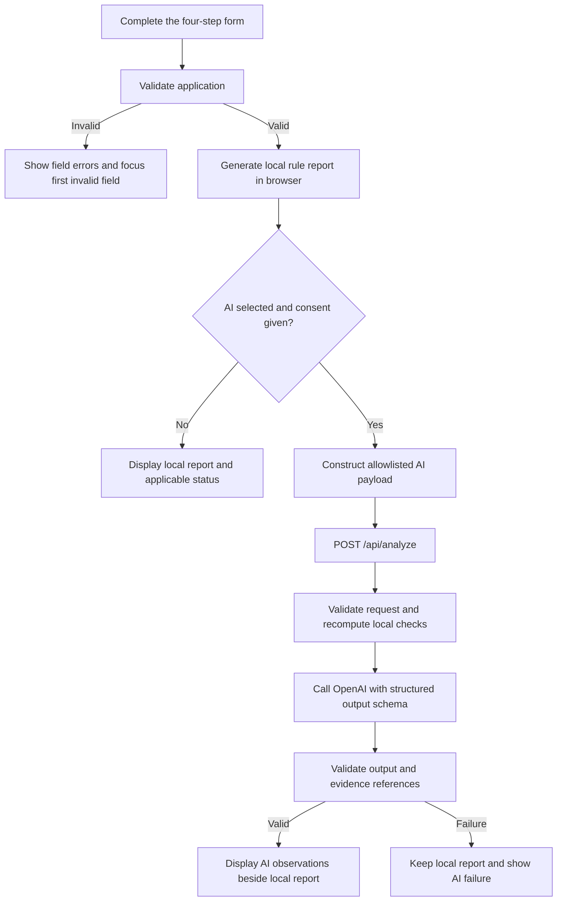
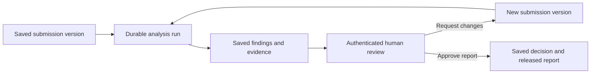

# VizeLens implementation audit

Audit date: 2026-11-04  
Repository revision inspected: `b375eb3`  
Scope: current implementation, with particular attention to **form submission → AI analysis → human approval**.

This document describes the code as it exists today. Proposed additions are marked separately. The audit does not change application behavior.

## 1. Current position

The repository implements a working, session-based application review prototype:

- A four-step Turkish application form with required-field and conditional validation.
- Deterministic checks for dates, accommodation coverage, and the entered budget.
- An optional server-side OpenAI integration that produces structured, evidence-linked observations.
- A report with editing, copying, printing, error handling, and protection against displaying late AI responses as current results.

**It does not implement a saved application workflow, a visa-risk score, or a human approval process.**

The current AI is explicitly instructed not to score a person, predict visa outcomes, or recommend approval/rejection. Human review is described in the interface, but there is no authenticated reviewer, approval button, approval API, or saved decision.

For the intended workflow, intake and analysis foundations exist. Persistence, review ownership, and enforceable human sign-off still need implementation. A completion percentage would be misleading because those missing capabilities are substantial parts of the product.

## 2. Implementation inventory

| Capability | Status | What exists today |
| --- | --- | --- |
| Application form | Implemented | Four steps, Turkish labels, summaries, back/edit navigation, and fictional examples. |
| Required fields | Implemented | Required text, selections, numbers, declarations, conditional details, and applicable accommodation records. |
| Submission validation | Implemented | Current step is checked before advancing; the full application is checked before generating a report. |
| Deterministic analysis | Implemented | Date arithmetic, accommodation gaps/overlaps/outside dates, and budget versus the user's estimate. |
| Server-side AI integration | Implemented in code | OpenAI SDK call through `POST /api/analyze`; live provider operation was not verified in this audit. |
| AI on every submission | Not implemented | Local-only analysis is the default. AI requires an explicit selection and sending consent. |
| Entire form sent to AI | Not implemented | An explicit subset is sent. All applicant-profile fields are excluded. |
| Evidence-linked AI observations | Implemented | Structured categories, explanations, field references, quotations, and clarification questions. |
| Numeric risk score / risk bands | Not implemented | No scoring formula, severity model, risk schema, thresholds, or calibration. |
| Visa approval/refusal prediction | Explicitly outside current behavior | Prohibited by the prompt and partially screened by output validation. |
| Report display and export | Implemented | Local and AI results appear separately; clipboard export and browser printing exist. |
| Human approval | Not implemented | No reviewer identity, assignment, decision, or approval record. |
| Saved applications and history | Not implemented | Application and report state live in browser memory. |
| Login and access control | Not implemented | No applicant/reviewer/admin roles or case access checks. |
| Background analysis jobs | Not implemented | Analysis runs inside the HTTP request. |
| Document upload / OCR | Not implemented | The form accepts fictional text excerpts, not uploaded evidence. |
| Country-specific requirements | Not implemented | Destination is context; there is no official requirements source or versioned checklist. |
| Automated tests | Implemented | Unit/integration-style tests and Playwright browser scenarios. |

Sources: [application form](src/components/application-form.tsx), [workspace](src/components/workspace.tsx), [analysis handler](src/server/analyze.ts), [AI contracts](src/lib/ai-contract.ts), [report](src/components/review-report.tsx), and [package manifest](package.json).

## 3. What happens when the user submits

1. `ApplicationForm.submit()` validates the complete application and calls the parent callback. This is not a database submission.
2. `Workspace.analyze()` calls `reviewApplication()` locally and immediately opens the report.
3. Local-only mode ends there. Selecting AI without consent produces a `consent_required` status while retaining the local report.
4. With AI and consent enabled, `toAIRequest()` constructs the permitted payload.
5. `requestAI()` validates that payload, applies a basic identifier-pattern check, and sends the HTTP request.
6. The server validates the request again, computes local findings from the supplied context, and calls OpenAI.
7. The returned observations are validated on the server and again in the client.
8. Results remain in the current browser session. No case, submission receipt, or analysis history is stored.

Editing cancels the pending request and marks the report stale. A generation counter prevents an older response from replacing a newer result. This protects the current browser session; it is not a persistent version-control or job-management mechanism.

Sources: [form submission](src/components/application-form.tsx), [workspace orchestration](src/components/workspace.tsx), [AI client](src/lib/ai-client.ts), [API route](src/app/api/analyze/route.ts).

## 4. Form and validation already implemented

The four steps are:

1. Application and travel: reference, destination, purpose, dates, and travel-purpose explanation.
2. Personal information and travel history: employment, age, education, countries visited, visa/residence history, refusals, languages, and relatives.
3. Funding, accommodation, and declarations: currency, budget, estimated cost, payment methods, assets, stays, explanations, and declaration checkboxes.
4. Explanations and review: editable summary, review note, fictional excerpts, and analysis method.

The recent required-field behavior is present in the audited revision:

- Blank and whitespace-only required text is rejected.
- Yes/no questions require an explicit answer.
- Details are required when the corresponding answer is Yes.
- Hidden conditional answers are removed from the validated copy; the raw form preserves them for toggling back.
- At least one funding method is required; asset types are required when assets are declared.
- Travel regions are required when the visited-country count is greater than zero. A count of zero removes those regions from the active data.
- Overnight trips require at least one stay; same-day trips can have no stays.
- Return cannot precede departure; stay checkout must follow check-in.
- All four declaration checkboxes must be checked.
- Numeric bounds, date validity, and text-length limits are checked.

The form currently offers four destinations, three travel purposes, and three currencies. It does not collect a specific visa category or a complete set of country-dependent application requirements.

Sources: [application schema](src/lib/validation.ts), [profile schema and normalization](src/lib/applicant-profile.ts), [step validation](src/lib/application-steps.ts), [narrative schema](src/lib/narratives.ts), [profile fields](src/components/applicant-profile-fields.tsx).

## 5. Exactly what the AI receives

The application does **not** forward the entire submitted form.

| Information | Used in local workflow | Sent to OpenAI |
| --- | --- | --- |
| Application reference | Yes | No |
| Destination and travel purpose | Yes | Yes |
| Departure and return dates | Yes | Yes |
| Currency, budget, estimated cost | Yes | Yes |
| Accommodation type and dates | Yes | Yes |
| Four declaration values | Yes | Yes |
| Travel-purpose explanation | Yes | Yes |
| Funding explanation | Yes | Yes |
| Accommodation explanation | Yes | Yes |
| Fictional document excerpts | Yes | Yes |
| Private review note | Yes | No |
| Employment, occupation, start year | Yes | No |
| Age, marital status, birth country, education | Yes | No |
| Travel-history count and regions | Yes | No |
| Visa/residence countries and refusal history/details | Yes | No |
| Languages and relatives/details | Yes | No |
| Asset types and payment methods | Yes | No |

The browser sends `context`, `narratives`, and an `anonymized: true` declaration to the application server. The server constructs a model message containing labeled evidence fields, calculated trip/covered nights, and local rule findings. It does not forward the browser object unchanged.

The `anonymized` value records a client assertion for this request. It is not proof of anonymization or a durable consent record. Narrative text can still contain personal information that the pattern check does not recognize.

Sources: `toAIRequest()`, `evidenceSources()`, and `aiRequestSchema` in [AI contracts](src/lib/ai-contract.ts); model input construction in [analysis handler](src/server/analyze.ts).

## 6. What analysis exists

### Deterministic rules

The local engine calculates trip nights, covered nights, uncovered nights, and overlapping nights. It creates findings for:

- Accommodation that covers only part of the trip.
- Overlapping accommodation intervals.
- Accommodation outside the trip dates.
- Budget below the user's own estimated cost.

Missing-accommodation and missing-declaration finding branches also remain in the engine. Under the current required-field schemas, valid overnight applications cannot omit all stays and valid applications cannot have unchecked declarations. Those branches are therefore normally unreachable through the current submission flow.

These checks compare entered information. They do not verify document authenticity, retrieve official financial thresholds, assess eligibility, or convert currencies. The personal profile does not influence these findings.

Source: [review engine](src/lib/review.ts).

### AI observations

The model can return up to eight observations. Each contains:

| Field | Current purpose |
| --- | --- |
| `category` | Contradiction, missing explanation, or ambiguity. |
| `title` | Short description of the issue. |
| `explanation` | Why the issue needs clarification. |
| `evidence[]` | One to five field references and quotations. |
| `question` | A question for human follow-up. |

Validation checks the structure, verifies that referenced fields exist, and checks that quotations occur in those fields. A text-pattern filter rejects some prohibited personal judgments and outcome predictions.

The schema has no risk score, risk level, probability, recommendation, reviewer decision, or approval status. Extra output fields are rejected.

A matching quotation establishes that text exists in the input; it does not prove that the model's interpretation is correct. The eight-observation cap and absence of a coverage checklist also mean that an empty or short result is not proof that every issue was checked.

Sources: `aiOutputSchema` and `validateAIOutput()` in [AI contracts](src/lib/ai-contract.ts); `INSTRUCTIONS` in [analysis handler](src/server/analyze.ts).

## 7. Existing reliability and request protections

Implemented controls include:

- Server-only API key and model configuration through environment variables.
- Explicit AI payload construction and strict top-level request contracts.
- JSON content-type validation, a 64 KiB streamed request-body limit, and a five-second body-read timer.
- Rejection of a supplied Origin header that differs from the request URL origin.
- Basic identifier-pattern checks on narrative text in both client and server.
- A 25-second provider timeout and 30-second client timeout.
- No automatic SDK retries; an explicit retry action is available in the UI for eligible failures.
- Structured model output, evidence checking, refusal/incomplete-output handling, and client-side response validation.
- `store: false` in the provider request and `Cache-Control: no-store` on application API responses.
- SDK logging disabled; raw provider exceptions and credentials are not returned to the user.
- Local-report fallback when AI is unavailable, rejected, cancelled, or invalid.
- In-session duplicate-request prevention and ignoring obsolete responses.

These controls do not provide authentication, authorization, persistent consent, quotas, or durable job processing. In particular, the Origin check allows requests without that header and is not an access-control mechanism. Aborting a browser request also does not establish that provider work or billing was cancelled.

Sources: [server handler](src/server/analyze.ts), [client](src/lib/ai-client.ts), [workspace](src/components/workspace.tsx), [identifier check](src/lib/narratives.ts).

## 8. Human review and approval: current reality

Human review is currently supported through presentation:

- The report shows findings, evidence, and clarification questions.
- Profile information is visible for a person to inspect.
- Users can return to the form and generate a new report.
- The UI states that AI observations require human verification.

There is no implemented workflow for:

- Identifying a reviewer or distinguishing an applicant from a reviewer.
- Assigning cases or showing a review queue.
- Accepting, dismissing, or resolving individual findings.
- Requesting corrections and tracking a resubmission.
- Approving/rejecting a report or recording a reason.
- Recording who reviewed which application/analysis version and when.
- Preventing the submitter from approving their own case.
- Requiring approval before releasing a final result.

Copy and print are blocked when a report is stale, but **they are not gated by human approval or even successful AI completion**. The user can export a current local report while AI is pending or unavailable.

Sources: [report actions](src/components/review-report.tsx), [AI observation display](src/components/ai-observations.tsx), [workspace state](src/components/workspace.tsx), and the API route inventory under [src/app](src/app).

## 9. Audit findings and implementation gaps

Priorities below describe their importance for the proposed shared review product. Missing production features are not being represented as defects in the deliberately local prototype.

| Priority | Finding | Evidence / consequence | Next implementation needed |
| --- | --- | --- | --- |
| P0 | No durable submission | Form/report state is held in React; reload loses the case. | Save applications and immutable submitted versions; return a case ID. |
| P0 | No approval boundary | There are no decision endpoints, roles, or decision records. | Authenticated review queue, decision service, and server-enforced release gate. |
| P0 | Risk-analysis meaning differs from current behavior | Prompt prohibits scoring and visa-outcome predictions; output schema has only observations. | Define the intended assessment, its rubric, evidence requirements, and meaning of approval before changing the prompt/schema. |
| P0 for shared deployment | Analysis endpoint has no user authorization or spend controls | Valid requests can reach the configured provider without a user identity. | Authentication, object access checks, quotas, and rate/concurrency limits. |
| P1 | AI does not see applicant profile | Employment, travel/refusal history, assets, and other profile answers are excluded. | Decide which fields are necessary for the assessment, then update payload, disclosure, and tests deliberately. |
| P1 | Required-field design cannot represent some applicants truthfully | Employment year is mandatory; sectors have no no-employment-history option. | Add explicit employment/applicability states and conditional requirements. |
| P1 | Applicant and reviewer content are mixed | A private review note is required in the same form the applicant would fill. | Separate applicant input from reviewer-only notes in the future role-based flow. |
| P1 | Fictional evidence is required | Fictional excerpts are mandatory; no real document pipeline exists. | Keep this as demo behavior or define a real evidence workflow before using it for actual applications. |
| P1 | Form and AI limits differ | The form accepts 21 stays; the AI contract rejects more than 20. | Share collection limits and show them before submission. |
| P1 | Analysis has no durable identity or provenance | No stored run ID, input snapshot, prompt/rule version, provider response ID, or usage record. | Persist versioned analysis runs and their execution metadata. |
| P1 | No durable processing/recovery | A request-bound operation has no job queue, persistent retry state, or cross-session deduplication. | Durable jobs with bounded retry, idempotency, and recovery behavior. |
| P1 | Evidence validation is structural, not semantic | A real substring can still be used to support an incorrect conclusion. | Evaluation cases, review feedback, coverage tracking, and finding dispositions. |
| P2 | Legacy missing-information branches conflict with new input rules | Required declarations and stays prevent those findings in valid submissions. | Decide whether incomplete cases should be blocked or accepted for review; align schemas, rules, and examples. |

The stay-limit mismatch and rejection of a blank employment-start year were reproduced with synthetic input during the audit. The other findings were established by inspecting the relevant paths and repository inventory.

## 10. What remains for the intended workflow

This section is a proposed implementation sequence, not functionality that currently exists.

### Step 1: Define the product decision

Specify whether “risk” means incomplete/inconsistent application evidence, a reviewer-priority classification, or a prediction of visa refusal. Those are different products. The current implementation supports the first interpretation only, without a severity score.

Specify what the person approves: the accuracy of the analysis, readiness to submit an application, or some other internal decision. An internal review approval should have an explicit name and scope.

If refusal probability is intended, the current repo has no outcome dataset, prediction model, calibration, or measured predictive performance. That would require a separate data and evaluation workstream; changing the prompt to return a percentage would not supply those missing capabilities.

### Step 2: Save and identify cases

Add authenticated users, case ownership, a database, draft saving, submitted application versions, and a server-side submission endpoint. Validate the complete submission on the server; the current API validates only its AI subset.

Persist at least:

- Application and immutable submitted version.
- Analysis run tied to that exact version.
- Local findings and AI observations, preserving their different sources.
- Reviewer assignment and finding dispositions.
- Decision, reviewer identity, rationale, and timestamp.
- Audit events and the applicable data-sharing record.

### Step 3: Run analysis independently of the browser

Submission should create durable analysis work and return a case/job identifier. The worker should load the saved version, build the permitted payload, run checks and AI, validate results, and save success or failure.

Include request deduplication, bounded retries, failure visibility, and an explicit policy for AI-unavailable cases. A failed analysis must not silently become a completed assessment.

### Step 4: Add the reviewer workflow

Provide a queue and case detail view containing the submitted version, evidence, local findings, AI observations, and analysis status. Allow the reviewer to record finding dispositions and either approve the report, request changes, or escalate it.

The server must check reviewer permissions and confirm that the decision refers to the current application version and selected analysis run. New submitted data or a replacement analysis must trigger fresh review rather than inherit an old approval automatically.

### Step 5: Release a reviewed result

Generate a final report from the saved, approved version. Distinguish drafts and failed/pending analysis from approved results. Record the released version and decision reference.

Add tests for unauthorized access, stale approval attempts, simultaneous reviewers, retries, provider failures, resubmissions, and recovery after a browser or server restart.

The smallest complete target flow is:

## 11. Verification performed

During this audit, using the locally installed Node.js 22 runtime:

| Check | Result |
| --- | --- |
| `npm run typecheck` | Passed. |
| `npm run lint` | Passed. |
| `npm test` | Passed: 30 tests, zero failures. |
| Synthetic 21-stay application | Accepted by full application schema; rejected by AI request schema. |
| Synthetic application without employment-start year | Rejected by current application schema. |
| AI payload inspection | Confirmed profile, reference, and private notes are excluded. |

The existing tests cover rules, dates, required fields, conditional normalization, payload boundaries, SDK behavior with a mocked transport, invalid responses, evidence references, cancellation, and timeout handling.

The repository also contains 11 Playwright scenarios configured across six viewport projects. They cover navigation, required fields, profile toggling, report freshness, copying/printing, hydration, responsiveness, and mocked AI behavior. Browser tests and production build were not rerun as part of this documentation audit; they were exercised in the preceding form-change work.

No live OpenAI request was made. The API key's validity, configured model access, real model quality, production infrastructure, and end-to-end human approval cannot be certified by these checks. No personal application data was used.

Sources: [unit tests](tests), [browser tests](tests/browser), [Playwright configuration](playwright.config.ts).

## 12. Code map

| File | Responsibility |
| --- | --- |
| [src/components/application-form.tsx](src/components/application-form.tsx) | Form state, navigation, required-field errors, examples, analysis selection. |
| [src/components/applicant-profile-fields.tsx](src/components/applicant-profile-fields.tsx) | Personal, travel, and financial fields with conditional rendering. |
| [src/lib/validation.ts](src/lib/validation.ts) | Full application validation. |
| [src/lib/applicant-profile.ts](src/lib/applicant-profile.ts) | Profile validation, conditional normalization, labels. |
| [src/lib/application-steps.ts](src/lib/application-steps.ts) | Per-step validation and error-to-step mapping. |
| [src/lib/narratives.ts](src/lib/narratives.ts) | Narrative limits and basic identifier-pattern detection. |
| [src/components/workspace.tsx](src/components/workspace.tsx) | Local report creation, AI orchestration, cancellation, stale-state handling. |
| [src/lib/review.ts](src/lib/review.ts) | Deterministic findings and text report. |
| [src/lib/ai-contract.ts](src/lib/ai-contract.ts) | Payload boundary, evidence sources, schemas, output validation, AI statuses. |
| [src/lib/ai-client.ts](src/lib/ai-client.ts) | Browser HTTP call, timeout, and response validation. |
| [src/app/api/analyze/route.ts](src/app/api/analyze/route.ts) | Server route and environment configuration. |
| [src/server/analyze.ts](src/server/analyze.ts) | Request protections, prompt, SDK call, and provider response handling. |
| [src/components/review-report.tsx](src/components/review-report.tsx) | Report display, copying, printing, editing, and stale restrictions. |
| [src/components/ai-observations.tsx](src/components/ai-observations.tsx) | AI observation and failure-state display. |

